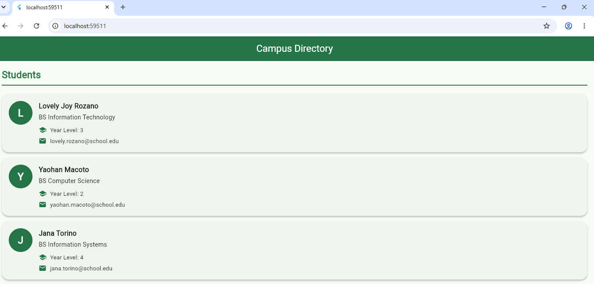
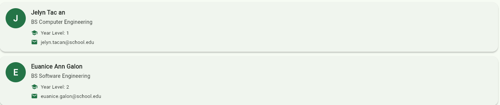

# Laboratory Activity 2: Building a Student Directory with Stateless Widget

**Name:** Lovely Joy B. Rozano

**Course:** BS Information Technology

## Description

This project is a Flutter application that displays a campus student directory using StatelessWidget classes.

## Features

- Displays five students.
- Shows each student's name, course, year level, and email.
- Uses reusable Flutter widgets.
- Uses a green theme and customized student cards.
- Does not use StatefulWidget or setState.

## Screenshot

